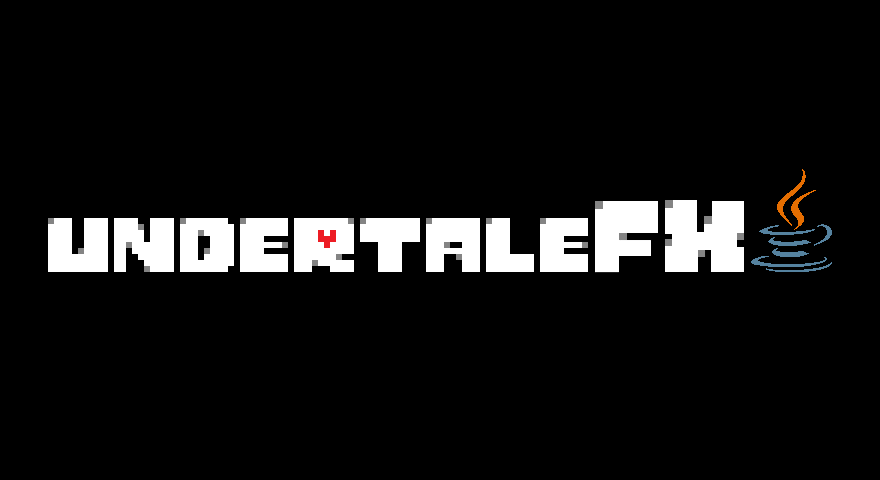
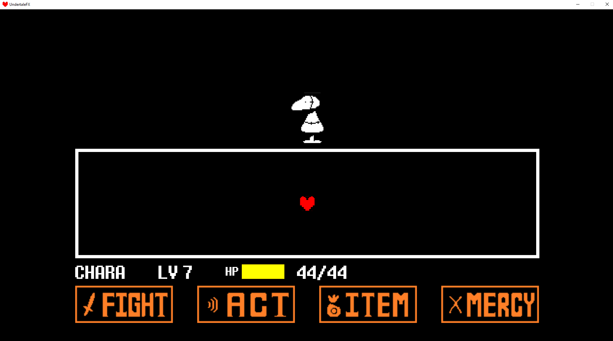
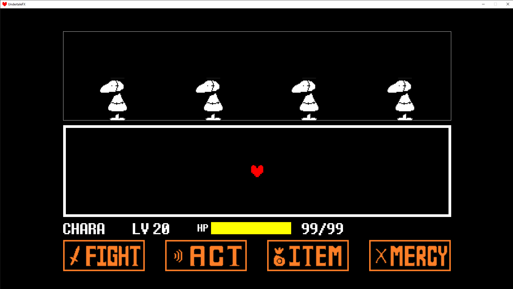

# UndertaleFX

UndertaleFX is a Java project aimed at emulating the battle mode of the popular game Undertale using JavaFX. This project is still in development but already showcases impressive features, including a functional menu with buttons reminiscent of Undertale's "FIGHT," "ACT," "ITEM," and "MERCY" options. 

While enemies themselves are still experimental, it is already possible to spare them by acting in specific ways. The implementation allows for easy creation of enemies, thanks to Java being OOP.

Additionally, UndertaleFX includes a developer mode. In this mode, you can access additional functionality that aids in testing and development, like increasing/decreasing the players level, adding / removing enemies and a lot more.

Original sounds, as well as music have also been added already . So far it plays exactly like Undertale, whilst also supporting some other keys one might prefer over the arrow keys for control over the player.

UndertaleFX is inspired by Toby Fox's game Undertale. I would like to acknowledge Toby Fox and the entire Undertale development team for creating such a fantastic game that serves as the foundation for this project. The goal of this project is to increase my programming skill and Java/JavaFX knowledge.

 
 
 

## Disclaimer

UndertaleFX is a non-commercial fan project. It is not affiliated with, endorsed by, or sponsored by Toby Fox or anyone involved in the development of Undertale.

**Undertale and all of its sprites, sound effects and music are © Toby Fox.** The game assets in `src/main/resources` were taken from Undertale and are included solely for non-commercial, educational purposes. I do not claim any ownership of them. If you are a rights holder and would like any of this material removed, please open an issue and I will take it down.

The Determination Mono and Determination Sans fonts (`src/main/resources/fonts`) are fan-made fonts and belong to their respective creator. They are subject to their own license.

Do not sell or commercially distribute this project or any build of it.

## License

The **source code** of this project is licensed under the [MIT License](LICENSE).

This license applies only to the code written for this project. It does not cover the Undertale assets or the fonts described above, which remain the property of their respective owners.
